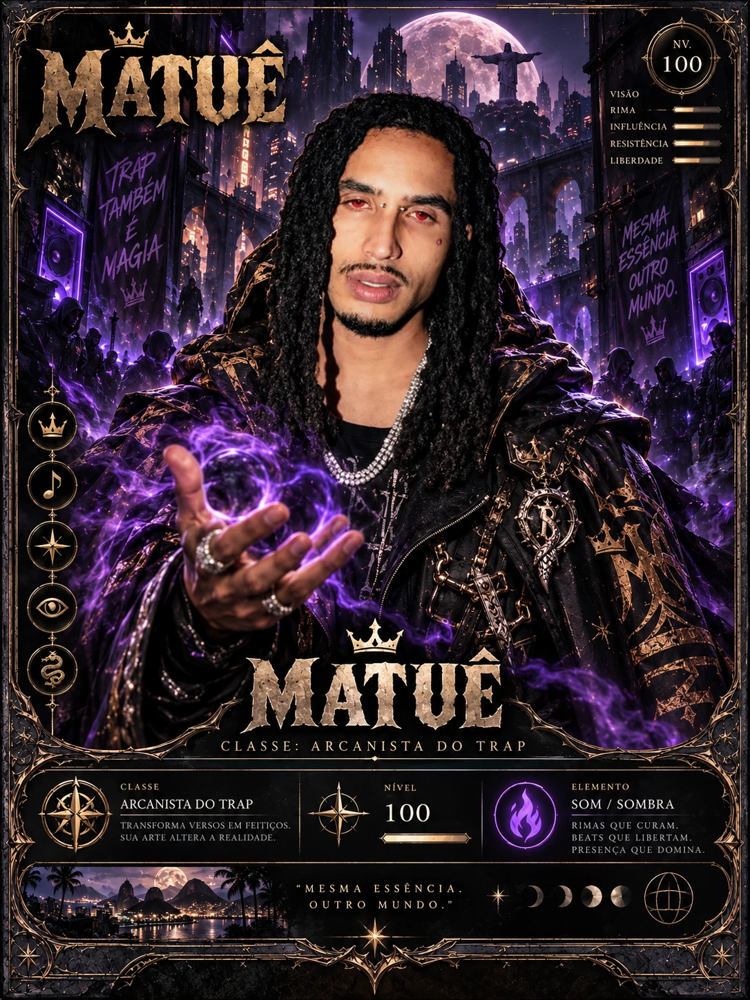
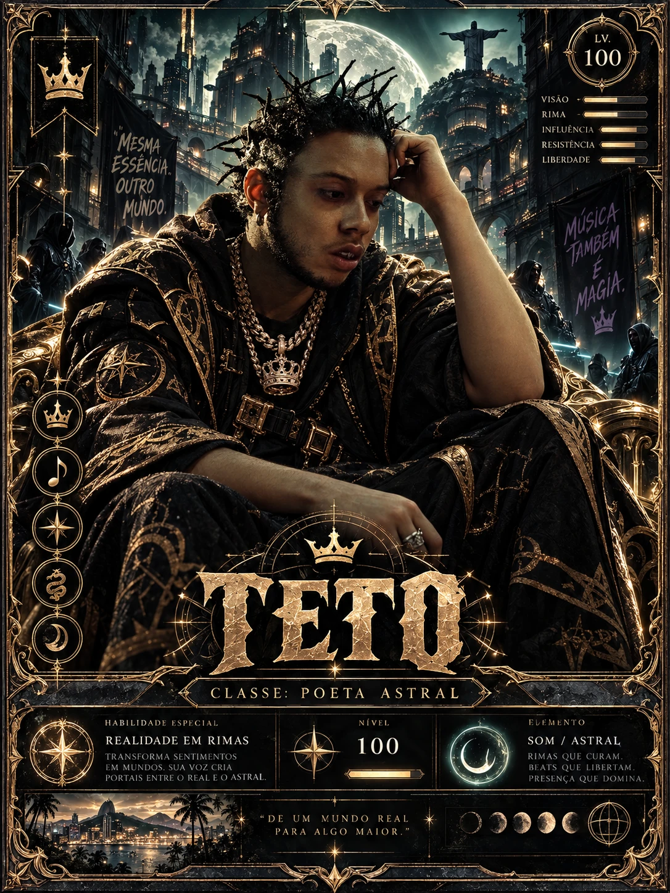
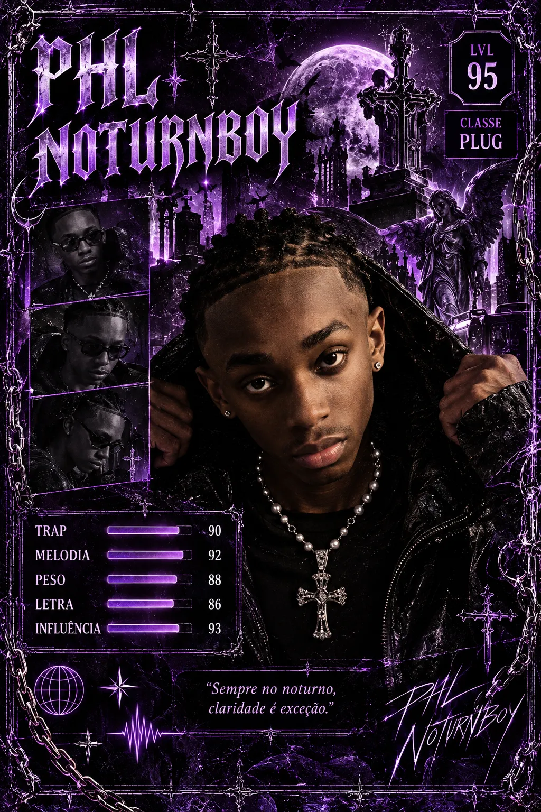
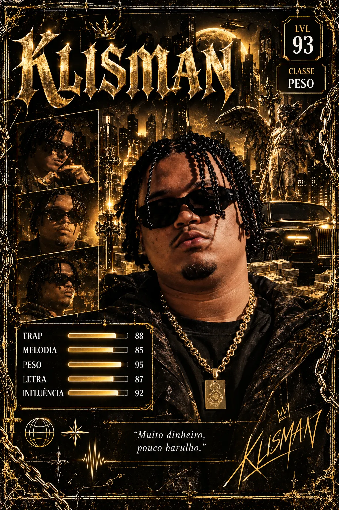

<p align="center">
  
</p>

# Trap RPG: Duelo de Cartas

App mobile em **Flutter** + **Supabase**: um RPG de cartas por turnos com os trappers brasileiros
**Alee, Matuê, Teto, Klisman, Leviano, Phlnoturnboy, FabGoDamn, Reid, Stef e Fabin**.

O jogador cria a conta, monta um time de até 3 cartas, enfrenta missões (batalhas), ganha pontos,
recruta novas cartas, desbloqueia conquistas e disputa o ranking.

| | |
|---|---|
| **Curso** | Técnico em Desenvolvimento de Sistemas (SENAI) |
| **Atividade** | Fixação e Aprofundamento — Flutter 8 (tema original: "EcoQuest") |
| **Professores** | Luis Felipe Cardoso e Lucas Machado |
| **Dupla** | Caio Machado e Lucas Henrique |
| **Entrega** | 09/11/2026 |

<p align="center">
  
  
  
  
  
</p>

---

## Funcionalidades

| Requisito da atividade | Como foi feito no Trap RPG |
|---|---|
| Splash Screen | Logo animado (cartas em leque) e redirecionamento automático para Home ou Login conforme a sessão |
| Login e cadastro | Supabase Auth (e-mail + senha), mensagens de erro em português, logout |
| Home / Central de missões | Saudação, pontuação, nível, missões concluídas, missão em destaque, lista agrupada por categoria, filtros por status/categoria/dificuldade |
| Detalhes da missão | Título, descrição, categoria, dificuldade, pontos, "Como vencer", time rival, recompensa, status e botões Iniciar → Batalhar |
| Status das missões | Disponível, Em andamento e Concluída (tabela `user_missions`) |
| Conclusão | Vencer a batalha chama a função `complete_mission` no banco: registra, soma pontos **uma única vez** e verifica conquistas |
| Conquistas | 10 conquistas com nome, descrição, ícone, condição e barra de progresso; bloqueadas aparecem em cinza com cadeado |
| Ranking | Calculado no banco (`get_ranking`), pódio para o top 3 e destaque da posição do usuário logado |
| Perfil | Apelido (editável), e-mail, pontuação, missões, conquistas, cartas, histórico e logout |

### Diferenciais implementados (todos funcionam de verdade)
- **Arte oficial de cada carta** (pôsteres dos 10 trappers) na coleção, na montagem do time,
  nas recompensas e nos avatares (o rosto é recortado automaticamente da arte).
- **Música dos trappers**: toca a faixa do artista na coleção e como trilha da batalha
  (veja "Músicas" abaixo), além do botão "Ouvir no Spotify".
- **Responsivo no Flutter Web**: barra inferior no celular, menu lateral no tablet/computador,
  grades que mudam de colunas, telas de login divididas e conteúdo centralizado em telas largas.
- **Batalha de cartas por turnos** com HP, ataque, defesa, especiais e vantagem de elemento.
- **Coleção de cartas**: começa com 3 cartas e recruta as outras vencendo missões.
- **Nível do jogador** (a cada 200 pts) que aumenta os atributos das suas cartas.
- **Filtros** por status, categoria e dificuldade.
- **Efeitos visuais** ao desbloquear conquistas e ao receber dano/cura na batalha.
- **Histórico de vitórias** no perfil.

---

## Como a batalha funciona
1. Escolha até 3 cartas da sua coleção.
2. No seu turno, toque em uma carta sua (quem age) e em um rival (alvo).
3. **Atacar** gera 1 de Hype. Com 3 de Hype você pode usar o **Especial** da carta.
4. Tipos de especial: dano alto, perfurante (ignora defesa), em área, dreno de vida, atordoar e cura do time.
5. Elementos: Fogo > Gelo/Vento, Gelo > Vento/Tempestade, Vento > Terra, Terra > Tempestade/Fogo,
   Tempestade > Fogo/Gelo, Sombra ⇄ Luz. Cósmico causa +15% contra todos.
6. Nocauteie todas as cartas rivais para vencer.

---

## Estrutura do projeto

```
lib/
├── main.dart                     # Inicializa o Supabase e o app
├── assets/                       # Dentro de lib/ para ir junto no .zip de entrega
│   ├── logo.webp                 # Logo do Trap RPG
│   ├── cards/<id>.webp           # Arte de cada carta (alee.webp, matue.webp...)
│   └── music/<id>.mp3            # Músicas dos trappers (você adiciona)
├── core/
│   ├── router.dart               # GoRouter: rotas, abas e proteção de login
│   ├── responsive.dart           # Breakpoints, grade e centralização responsivas
│   ├── card_art.dart             # Posição do rosto em cada arte (avatares)
│   ├── supabase_config.dart      # URL e chave pública do Supabase
│   ├── theme.dart                # Cores e tema escuro
│   ├── game_meta.dart            # Ícones/cores de elementos, categorias, níveis
│   └── errors.dart               # Mensagens de erro amigáveis
├── models/                       # TrapperCard, Mission, Achievement, PlayerProfile...
├── services/
│   ├── auth_service.dart         # Login, cadastro e logout
│   ├── game_repository.dart      # Todas as consultas e RPCs do Supabase
│   └── music_service.dart        # Toca as músicas (audioplayers)
├── game/
│   └── battle_engine.dart        # Regras da batalha (Dart puro, testável)
├── widgets/                      # Widgets personalizados reutilizáveis
│   ├── mission_card.dart         # MissionCard
│   ├── progress_card.dart        # ProgressCard
│   ├── achievement_badge.dart    # AchievementBadge
│   ├── trapper_card_widget.dart  # Carta de RPG com a arte completa
│   ├── trapper_avatar.dart       # Avatar redondo (rosto recortado da arte)
│   ├── card_viewer.dart          # Arte em tela cheia + atributos + música
│   ├── music_button.dart         # Tocar música / Ouvir no Spotify
│   ├── status_badge.dart         # StatusBadge / InfoChip
│   ├── state_views.dart          # Loading / Empty / Error / FutureView
│   └── app_logo.dart             # Logotipo
└── screens/                      # Splash, Login, Cadastro, Home, Detalhes, Batalha,
                                  # Coleção, Conquistas, Ranking e Perfil
supabase/
└── schema.sql                    # Tabelas, RLS, funções e dados iniciais
```

### Widgets personalizados
Todos recebem os dados por parâmetro e são usados em várias telas:
`MissionCard`, `ProgressCard`, `AchievementBadge`, `TrapperCardWidget`, `TrapperAvatar`,
`StatusBadge`/`InfoChip` e `FutureView` (carregando/erro/conteúdo).

### Rotas (GoRouter)
- `/` Splash · `/login` · `/register`
- Abas com `StatefulShellRoute`: `/home`, `/collection`, `/achievements`, `/ranking`, `/profile`
- `/mission/:id` — detalhes (recebe o **id pela URL** e o objeto `Mission` via `extra`)
- `/mission/:id/battle` — batalha
- O `redirect` do GoRouter bloqueia todas as rotas internas sem sessão e o `refreshListenable`
  escuta o `onAuthStateChange` do Supabase (login/logout redirecionam sozinhos).

### Banco de dados (Supabase / PostgreSQL)

| Tabela | Finalidade |
|---|---|
| `profiles` | Apelido e pontuação do jogador (1:1 com `auth.users`) |
| `cards` | As 10 cartas de trappers e seus atributos |
| `missions` | Missões: categoria, dificuldade, pontos, time rival, recompensa |
| `user_missions` | Missões iniciadas/concluídas por usuário (PK `user_id + mission_id`) |
| `achievements` | Conquistas e regras de desbloqueio |
| `user_achievements` | Conquistas desbloqueadas por jogador |
| `user_cards` | Coleção de cartas de cada jogador |

**Como os dados do usuário se relacionam com as missões:** toda linha de `user_missions`,
`user_achievements` e `user_cards` tem `user_id` ligado a `auth.users`. A chave primária
`(user_id, mission_id)` garante uma linha por missão por jogador.

**Segurança:**
- RLS ativado em todas as tabelas: cada jogador só lê os próprios dados privados.
- O app **não tem permissão de INSERT/UPDATE** nas tabelas do jogo; só pode alterar a coluna `nickname` do próprio perfil.
- Pontos, conclusões, cartas e conquistas só mudam pelas funções `start_mission` e `complete_mission`
  (`security definer`), que usam `auth.uid()`. Assim a pontuação não pode ser manipulada pelo cliente
  e a mesma missão não dá pontos duas vezes.
- Um trigger (`on_auth_user_created_trap`) cria o perfil e entrega as 3 cartas iniciais no cadastro.

---

## Como executar

> **Atalho:** o app já vem apontando para o projeto Supabase da dupla
> (`lib/core/supabase_config.dart`), com o banco criado. Basta rodar o passo 2.
> A chave que está no código é a chave **pública** (publishable), feita para ficar no app:
> quem protege os dados são as políticas RLS e as funções do banco.
> Os passos abaixo são para quem quiser usar um projeto Supabase próprio.

### 1. Supabase (projeto próprio, opcional)
1. Crie um projeto em [supabase.com](https://supabase.com).
2. Abra **SQL Editor**, cole o conteúdo de `supabase/schema.sql` e clique em **Run**.
3. Para facilitar a demonstração, em **Authentication → Sign In / Providers → Email** desative
   **Confirm email** (assim o cadastro já entra direto no app).
4. Em **Project Settings → API**, copie a **Project URL** e a chave **anon/publishable**.

### 2. Flutter
1. Coloque a URL e a chave em `lib/core/supabase_config.dart`
   (ou passe na execução com `--dart-define=SUPABASE_URL=... --dart-define=SUPABASE_ANON_KEY=...`).
2. Instale as dependências e rode:

```bash
flutter pub get
flutter run
```

> **Windows:** se aparecer "Building with plugins requires symlink support", ative o
> **Modo de Desenvolvedor** do Windows (Configurações → Sistema → Para desenvolvedores).
> Evite também pastas com caminhos muito longos.

---

### 3. Músicas (opcional)
Coloque os arquivos de áudio em `lib/assets/music/` com o id da carta como nome
(`matue.mp3`, `teto.mp3`, `alee.mp3`, `klisman.mp3`, `leviano.mp3`, `phlnoturnboy.mp3`,
`fabgodamn.mp3`, `reid.mp3`, `stef.mp3`, `fabin.mp3`). Formatos: mp3, m4a, ogg ou wav.
Depois rode `flutter pub get` e reinicie o app. O app detecta sozinho quais músicas existem:
- **Coleção** → toque numa carta → **Tocar música**.
- **Batalha** → toca a música de um trapper do seu time (ícone de nota no topo para silenciar).

Cartas sem arquivo mostram apenas **Ouvir no Spotify**.

### 4. Rodar no navegador (Flutter Web)

```bash
flutter run -d chrome
```

Redimensione a janela para ver o layout mudar entre celular, tablet e computador.

## Roteiro da apresentação (desafio final)
1. Cadastrar um usuário novo → entra direto na Home.
2. Mostrar as missões, os filtros e a missão em destaque.
3. Abrir "Primeiro Freestyle" → **Iniciar missão** → **Ir para a batalha** → vencer.
4. Ver os pontos subirem (Home e Perfil) e a carta da Stef recrutada.
5. Abrir Conquistas ("Primeira Rima" desbloqueada) e Ranking (posição destacada).
6. Fazer logout, entrar de novo e mostrar que tudo continua salvo no banco.

O roteiro completo, com o que falar em cada passo, a explicação de widgets/rotas/banco e as
perguntas prováveis, está em [`docs/APRESENTACAO.md`](docs/APRESENTACAO.md).

## Entrega

| Item exigido | Onde está |
|---|---|
| Aplicativo Flutter | este repositório |
| Integração com Supabase | `lib/services/` + `supabase/schema.sql` |
| Repositório público no GitHub com README | este repositório / este arquivo |
| .zip com `lib` + `pubspec.yaml` | gerado com o comando abaixo (enviado à parte) |
| Apresentação prática | [`docs/APRESENTACAO.md`](docs/APRESENTACAO.md) |

Gerar o .zip com apenas a pasta `lib` e o `pubspec.yaml` (as imagens e músicas já estão
dentro de `lib/assets`, então o projeto continua completo):

```powershell
Compress-Archive -Path lib, pubspec.yaml -DestinationPath entrega_trap_rpg.zip
```

---
*Projeto acadêmico, sem fins comerciais. Os personagens são uma homenagem de fã aos artistas da cena trap brasileira; atributos e histórias das cartas são ficção criada para o jogo.*
